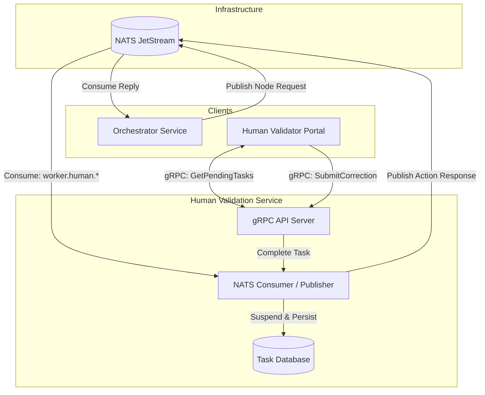

# Human Validation Service

Welcome to the **Human Validation Service**, the human-in-the-loop validation manager for the Document Processor system. When automated extractions fail schema or business rule validations, this service handles manual intervention workflows, seamlessly pausing and resuming jobs.

## Documentation Index

1. **[Core Components](docs/01_Core_Components.md)**  
   Overview of decoupled workflow processing and gRPC APIs.
2. **[How to Implement](docs/02_How_To_Implement.md)**  
   Instructions for local development and Docker deployment.
3. **[Service Communication](docs/03_Service_Communication.md)**  
   Details on resuming jobs and strict data contract mandates.

---

## High-Level Architecture

